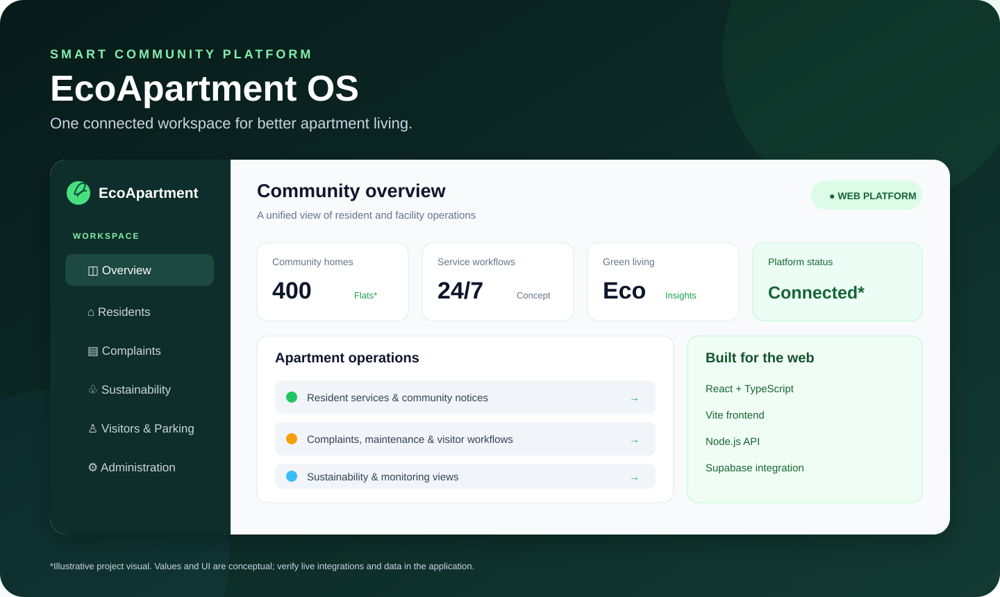

# 🌿 EcoApartment OS
### The digital command center for smarter, greener apartment communities

<p align="center">
  <a href="https://ecoapartment.vercel.app"></a>
  <a href="https://github.com/mohan05713/APP-PROJECT"></a>
  <a href="https://ecoapartment-os-api.onrender.com/api/health"></a>
</p>
<p align="center">
  
  
  
  
  
  
</p>

> **One community. One connected workspace. A smarter way to live.**

EcoApartment OS is a web-based apartment operations and sustainability platform concept. It brings resident services, facility workflows, visitor operations, maintenance, community updates and environmental monitoring views into one browser-accessible experience.

**Project scope:** This repository is maintained as a **web application**. The documented development and deployment workflow is for the browser-based product.

---

## ✨ Explore the project

| Destination | What you'll find |
|---|---|
| **[Launch EcoApartment OS](https://ecoapartment.vercel.app)** | Vercel project domain |
| **[Latest Vercel deployment](https://ecoapartment-h05n57u4q-mohan05713.vercel.app)** | Latest production deployment record |
| **[API health endpoint](https://ecoapartment-os-api.onrender.com/api/health)** | Backend health response |
| **[Render service dashboard](https://dashboard.render.com/web/srv-dbp3qabm8hqs73cogvc0)** | Backend service settings and logs |
| **[Vercel project dashboard](https://vercel.com/mohan05713/ecoapartment)** | Frontend deployments and domains |
| **[VS Code setup guide](README_VSCODE.md)** | Step-by-step local startup |

<details>
<summary><strong>Deployment snapshot — verified project records</strong></summary>

- Vercel project: `ecoapartment`
- Latest production deployment record: `READY`
- Render service: `ecoapartment-os-api`
- Latest Render deployment record: `live`
- Render region: Singapore
- Source repository: `mohan05713/APP-PROJECT`, branch `main`

**Access note:** Vercel reports SSO protection enabled for non-custom domains. If the app asks you to sign in, use an authorized Vercel account. A deployment marked READY means its build/deployment completed; it does not by itself guarantee every feature or API integration is working.

</details>

## 🖼️ Visual overview



<sub>This is a designed project overview illustration, not a captured application screenshot. The live Vercel deployment has SSO protection enabled, so an authenticated browser capture was not available during this repository update. Use the live app link above to view the actual interface.</sub>

## 🏙️ What the platform brings together

### Resident services
- Resident profile and directory experiences.
- Community notices and announcements.
- Visitor pass and gate-entry workflows.
- Maintenance dues and payment-status views.
- Complaint submission and status tracking.
- Family and flat information views.

### Facility operations
- Facility and administration dashboards.
- Complaint assignment and technician workflows.
- Visitor and parking management.
- Maintenance billing and operational reports.
- CSV/JSON export utilities where implemented.

### Sustainability and monitoring
- Water and environmental monitoring views.
- IoT telemetry and anomaly-related screens.
- LPG and energy information views.
- Sustainability reporting and eco-reward concepts.

> **Demo-data transparency:** Some views and server endpoints use seeded or simulated data. A displayed sensor, payment, IoT or visitor workflow should not be treated as a live external integration unless the required hardware/provider is connected and separately tested.

## 🧰 Technology stack

| Layer | Technologies | Purpose |
|---|---|---|
| Web interface | React, TypeScript/TSX, HTML5, CSS3 | Browser UI and reusable components |
| Frontend tooling | Vite | Local development and production build |
| API server | Node.js | HTTP routes and application API |
| Data services | Supabase / PostgreSQL | Hosted data layer when configured |
| Supporting tools | Python, SQL | Utilities, schema and supporting scripts |
| Source control | GitHub | Version history and collaboration |
| Hosting | Vercel + Render | Frontend and API hosting |

## 🧭 Architecture

```text
                 RESIDENTS / FACILITY TEAM
                           |
                           v
                    WEB BROWSER
                           |
                           v
              REACT + TYPESCRIPT FRONTEND
                           |
                  VERCEL WEB DEPLOYMENT
                           |
                       /api/*
                           |
                           v
                NODE.JS API ON RENDER
                           |
                  +--------+--------+
                  |                 |
                  v                 v
          SUPABASE / POSTGRES   DEMO / LOCAL DATA
          (when configured)    (seeded workflows)

              GitHub = source of truth
```

The Vercel rewrite forwards `/api/*` requests to the active Render service. The frontend and API can be deployed independently.

## 📁 Repository map

```text
APP-PROJECT/
├── src/
│   ├── components/       # Reusable React UI
│   ├── pages/            # Application pages
│   └── lib/              # Data, types and service utilities
├── app/
│   └── applet/           # Supporting web utilities
├── docs/
│   └── ecoapartment-overview.svg
├── index.html            # Web entry document
├── server.js             # Render Node.js service entry
├── server.ts             # npm start entry in package.json
├── server.py             # Supporting Python implementation
├── supabase_schema.sql   # Database schema
├── .env.example          # Environment template
├── package.json          # Dependencies and npm scripts
├── vite.config.ts        # Vite configuration
├── vercel.json           # API rewrite configuration
├── README.md             # Project overview
└── README_VSCODE.md      # Local setup guide
```

## 🚀 Run it in VS Code

### Requirements
- Node.js 20 LTS or newer: https://nodejs.org/
- Visual Studio Code: https://code.visualstudio.com/
- Git (optional): https://git-scm.com/

### 1. Clone the repository

```bash
git clone https://github.com/mohan05713/APP-PROJECT.git
cd APP-PROJECT
```

Or download the ZIP from GitHub and extract it.

### 2. Open the correct folder

Open the repository root in VS Code — the folder containing `package.json` — then choose **Terminal → New Terminal**.

### 3. Install packages

```bash
npm install
```

### 4. Start the frontend

```bash
npm run dev
```

Open the local address printed by Vite (normally **http://localhost:5173**).

### 5. Start the Node.js server (separate terminal)

```bash
npm start
```

The current package script runs `node server.ts`. It uses `PORT` if set, otherwise port **3000**. Open **http://localhost:3000**.

The Render service is configured separately to run `node server.js`. Do not assume the local npm start command and Render start command are identical.

### 6. Build for production

```bash
npm run build
npm run preview
```

Vite writes the build output to `dist/`.

For screenshots of the real UI, run the app locally or open the live app with an authorized account, navigate to a representative dashboard, and capture the browser window. Use synthetic/demo records only; never publish real resident information.

Full instructions: **[README_VSCODE.md](README_VSCODE.md)**

## 🔐 Environment and Supabase setup

1. Copy `.env.example` to your local environment file.
2. Create/open your Supabase project: https://supabase.com/dashboard
3. Review `supabase_schema.sql` before running it in the SQL Editor.
4. Configure the project URL and public anon key in the correct local/deployment environment.
5. Enable and test Row Level Security (RLS) policies before using resident information.
6. Keep private API keys and service-role credentials server-side.

Variables referenced by the project template may include:

| Variable | Purpose |
|---|---|
| `PORT` | Node server port |
| `NODE_ENV` | Runtime mode |
| `SUPABASE_URL` | Supabase project URL |
| `SUPABASE_ANON_KEY` | Public client key, protected by RLS |
| `GEMINI_API_KEY` | Only if a Gemini-powered server feature is enabled |

Never commit `.env`, database passwords, service-role keys, private API keys or real resident credentials.

## ☁️ Live deployment links

| Component | Verified URL |
|---|---|
| Main frontend domain | [https://ecoapartment.vercel.app](https://ecoapartment.vercel.app) |
| Latest production deployment | [Open deployment](https://ecoapartment-h05n57u4q-mohan05713.vercel.app) |
| Backend service | [https://ecoapartment-os-api.onrender.com](https://ecoapartment-os-api.onrender.com) |
| API health check | [https://ecoapartment-os-api.onrender.com/api/health](https://ecoapartment-os-api.onrender.com/api/health) |
| Render dashboard | [Open service](https://dashboard.render.com/web/srv-dbp3qabm8hqs73cogvc0) |
| Vercel dashboard | [Open project](https://vercel.com/mohan05713/ecoapartment) |
| GitHub repository | [APP-PROJECT](https://github.com/mohan05713/APP-PROJECT) |

### Health-check response

The Node server implements `/api/health`, `/health`, `/healthz` and `/ping`. A healthy response is JSON with a `status: "healthy"` field and service metadata.

**Render configuration note:** The current Render service has no explicit health-check path configured in its service settings. The endpoint exists in the server code; configure `/api/health` in Render's Health Check Path setting if you want Render to monitor it automatically. The endpoint should return HTTP 200.

## 🧪 Build and smoke-test checklist

```bash
npm install
npm run build
```

Before a release, manually verify:
- [ ] Frontend loads without a blank page.
- [ ] Main navigation and responsive layouts work.
- [ ] Resident, complaint, notice and visitor screens load.
- [ ] API requests reach the active Render service.
- [ ] `/api/health` returns HTTP 200 and healthy JSON.
- [ ] Supabase reads/writes work with RLS enabled (if configured).
- [ ] Browser console and server logs contain no unhandled errors.
- [ ] Demo data is clearly distinguished from live integrations.

## 🛡️ Security and privacy

- Use synthetic records in public demos and screenshots.
- Never publish resident phone numbers, emails, family details, passwords or access credentials.
- Use secure authentication and role-based authorization for protected actions.
- Configure Supabase RLS and least-privilege database access.
- Validate and authorize requests on the server; UI hiding is not authorization.
- Restrict production CORS to trusted origins.
- Rotate credentials that may have been exposed in source history.
- Add audit logging before handling real resident or financial information.

## 🗺️ Roadmap — where it can go next

These are proposed improvements, not claims of completed functionality.

| Horizon | Planned improvement |
|---|---|
| **Foundation** | [ ] Consolidate frontend/API configuration and document a single production workflow |
| **Trust & safety** | [ ] Secure authentication, role-based access and audit trails |
| **Data reliability** | [ ] Supabase migrations, complete RLS policies, backup and restore drills |
| **Live operations** | [ ] Real-time complaint, visitor and notice updates |
| **Smart sustainability** | [ ] Verified IoT device connections with live-vs-simulated data labels |
| **Engineering quality** | [ ] CI checks, type checking, automated tests and accessibility checks |
| **Observability** | [ ] Uptime monitoring, structured logs and deployment alerts |
| **Community experience** | [ ] Mobile-first refinements, multilingual support and resident feedback workflows |

## 🧩 Troubleshooting

| Issue | First thing to check |
|---|---|
| `node` or `npm` not found | Install Node.js LTS and reopen VS Code |
| Vite page not opening | Use the exact URL printed by `npm run dev` |
| Port already in use | Stop the other process or choose another `PORT` |
| API 404/502 | Check the Vercel rewrite, Render URL, service status and logs |
| Health check fails | Check the Render start command, listening port and `/api/health` route |
| Supabase connection error | Verify URL/key, schema, RLS and environment settings |
| Changes not visible | Confirm the correct Git branch and latest deployment |

## 🤝 Contributing

1. Create a focused feature branch.
2. Keep secrets and personal data out of commits.
3. Run the production build and relevant tests.
4. Document any new environment variables.
5. Open a pull request with a concise change and test summary.

## 📌 Project information

- **Repository:** https://github.com/mohan05713/APP-PROJECT
- **Frontend:** React + TypeScript + Vite
- **API:** Node.js on Render
- **Database integration:** Supabase when configured
- **Application scope:** Web-only

No license grant is stated here. Unless a LICENSE file is added, do not assume unrestricted reuse rights.
